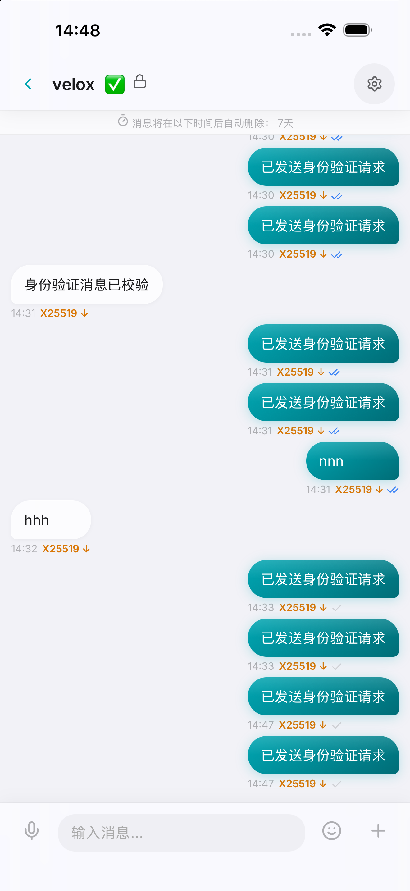
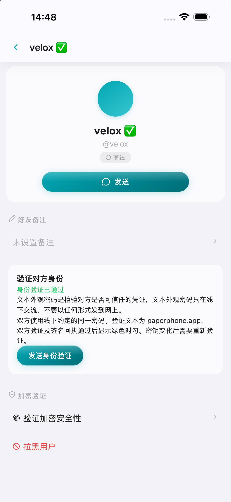
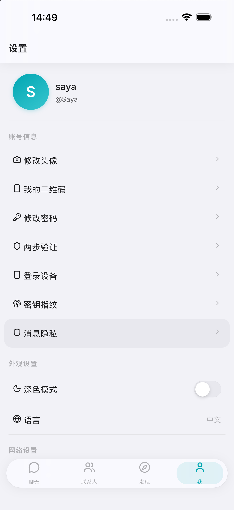

# PaperPhoneLite 3.1.0

[简体中文](README.md) · [English](README_EN.md) · [日本語](README_JA.md) · [한국어](README_KO.md) · [Français](README_FR.md) · [Deutsch](README_DE.md) · [Русский](README_RU.md) · [Español](README_ES.md)

[변경 기록](changelog.md)

        

PaperPhoneLite는 공개 소셜 기능이 없는 경량 종단간 암호화 메신저입니다.

📸 스크린샷 미리보기 (클릭하여 펼치기)

## 기능

- X25519 · XSalsa20-Poly1305 · Ed25519.
- 개인 채팅과 최대 2,000명의 Sender Key 암호화 그룹.
- 텍스트, 이미지, 동영상, 문서, 음성, 이모지 및 Telegram 스티커.
- 안정적인 WebSocket 동기화, 오프라인 전송 큐 및 계정별 캐시.
- 1일, 3일, 7일 또는 30일 후 메시지 자동 삭제.
- 친구 요청, 메모, 태그, 차단 및 QR 그룹 초대.
- TOTP 2FA, Android의 선택적 ntfy 알림, iOS의 사용자 지정 Bark 엔드포인트를 지원합니다. 서버는 기본적으로 `api.day.app`만 허용하며 자체 호스팅 Bark는 `BARK_ALLOWED_HOSTS`로 추가합니다.
- 최대 500MB 파일을 서버 영구 볼륨에 저장합니다. 사용자/친구 및 그룹 아바타는 영구 보관되고 채팅 첨부 파일은 서버 설정 기간 후 정리되며 이전 업로드는 자동으로 마이그레이션됩니다.
- 8개 UI 언어.

## 신원 확인, 서명 및 오프라인 동기화

다음은 아직 출시되지 않은 소스 변경 사항이며 버전은 3.1.0입니다. [변경 기록](changelog.md)을 참고하세요.

새 연락처와 텍스트 외관 비밀번호를 오프라인에서 합의한 뒤 기기에 설정하고 잠금을 해제하세요. **텍스트 외관 비밀번호는 상대방의 신뢰 여부를 확인하는 증명입니다. 오프라인에서만 공유하고 어떤 형태로도 온라인으로 보내지 마세요.** 고정 문자열 `paperphone.app`을 AES-GCM으로 암호화하고 양쪽 신원, 기존 12개 묶음의 안전 번호, 임의 챌린지를 결합한 뒤 암호화 봉투에 Ed25519 서명을 추가합니다. 양쪽 증명과 상대 챌린지 수신 확인이 모두 완료되어야 프로필 이름에 녹색 ✅가 표시됩니다. 안전 번호는 신뢰할 수 있는 오프라인 경로로 비교하세요.

개인 정보 페이지를 열면 공개키와 로컬 신뢰 기록을 다시 확인하고 기록에서 확인 응답을 복구합니다. 비밀번호가 잠금 해제되어 있으면 검증을 자동으로 시작하거나 이어갑니다. 반복해서 열어도 진행 중인 챌린지를 유지하며 재시도 빈도를 제한합니다. 키가 바뀌면 신뢰를 해제하고 오프라인 확인 후 수동 재검증이 필요합니다. 포커스와 화면 표시 복귀 시에도 갱신합니다.

모든 새 그룹 메시지는 서명과 Sender Key 암호화가 필수이며 기존 그룹도 마이그레이션됩니다. 암호화는 끌 수 없습니다. 키 배포 전에 각 구성원을 개인 채팅으로 검증해야 합니다. 구성원 목록을 열면 키와 신뢰 상태를 갱신하지만 일괄 개인 검증을 시작하지 않습니다. 서명은 그룹, 발신자, 키 세대, 메시지 ID, 유형, 신원 키, 이름, nonce, 암호문을 보호합니다. 신뢰된 키의 서명이 올바르면 녹색 ✅를 표시하며 복호화 키가 없으면 본문은 잠긴 상태로 재시도를 기다립니다.

가입·탈퇴·추방 시 키 세대가 증가합니다. 온라인 구성원은 알림 직후 각자의 발신 키를 교체하고 오프라인 구성원은 재접속 및 전송 전에 갱신합니다. 서버는 이전 세대의 전송과 키 게시를 거부합니다. 탈퇴자는 새 메시지와 키에 접근할 수 없고 재가입해도 부재 기간의 기록을 받을 수 없습니다. 남은 수신자의 과거 키는 보존하지만 탈퇴자가 이미 가진 키나 평문은 원격 삭제할 수 없습니다.

계정별 `server_seq`를 저장하고 끝까지 페이지를 가져와 과거 키 버전으로 복호화를 재시도합니다. 그룹 기록은 고정 순번으로 조회하며 전체 건수에 고정 상한이 없습니다. 로컬 캐시는 대화당 최대 2,000건이며 자동 삭제 기간은 유지됩니다. 이미 잃어버린 키는 복원할 수 없습니다.

현재 X25519, XSalsa20-Poly1305, Ed25519를 사용합니다. 기존 API의 `kem_pub`는 서명 공개키이며 실제 ML-KEM 양자 내성 키 등록이 아닙니다. 그룹 구성과 순서는 서버가 관리하며 MLS 합의가 아닙니다. 메타데이터와 업로드된 첨부 파일 자체는 이 서명 변경으로 종단간 암호화되지 않습니다.

서버와 모든 플랫폼 클라이언트를 함께 업그레이드해야 합니다. 이전 클라이언트는 새 서명 형식을 읽지 못합니다. 소스 변경이 앱이나 Docker 이미지 출시를 의미하지는 않습니다. [배포 및 이전](DEPLOY_EN.md), [테스트](client/tests/README.md)를 참고하세요.

## Tor 필수

Android, iOS, Windows 및 macOS 운영 클라이언트는 Tor를 내장하고 로그인 전에 Tor bootstrap 완료를 기다려야 하며, `.onion` 연결을 격리된 SOCKS5 회로로만 전송하고 clearnet으로 폴백해서는 안 됩니다. `client/`는 공유 UI 소스 코드만 포함합니다. 브라우저와 PWA는 운영 클라이언트로 지원되지 않습니다.

Moments, Timeline, 모든 통화, LiveKit, Cloudflare R2, 신고 및 검토 대시보드는 제거되었습니다. 운영 환경은 Docker Compose와 Tor v3 onion service만 사용합니다. [DEPLOY_EN.md](DEPLOY_EN.md)를 참조하세요.

서버 시작 시 이전 설치에 남아 있는 폐기된 Web Push 및 OneSignal 테이블과 오래된 식별자를 자동으로 삭제합니다.

Docker Compose가 시작되면 Tor 컨테이너가 전체 `http://...onion` 주소를 호스트의 `logs/onion-address.log`에 자동으로 기록하며, `docker compose logs tor`에서도 확인할 수 있습니다.

iOS 앱은 Apple App Store 배포를 목표로 합니다. Android APK는 Android 클라이언트 저장소의 [GitHub Releases](https://github.com/619dev/ppl-android/releases)에서만 배포하고 Google Play에는 게시하지 않으며 Google 푸시 또는 서비스 프레임워크를 포함하지 않습니다.

## 클라이언트 저장소

| 플랫폼 | 소스 코드 및 릴리스 |
|--------|---------------------|
| Android | [619dev/ppl-android](https://github.com/619dev/ppl-android) |
| iOS | [619dev/ppl-ios](https://github.com/619dev/ppl-ios) |
| macOS | [619dev/ppl-mac](https://github.com/619dev/ppl-mac) |
| Windows | [619dev/ppl-win](https://github.com/619dev/ppl-win) |

프로젝트가 유용하다면 콜라 한 캔을 사 주세요.

Telegram 그룹: https://t.me/+vHJtvWJY_gEyMTUx

라이선스: AGPL-3.0.
